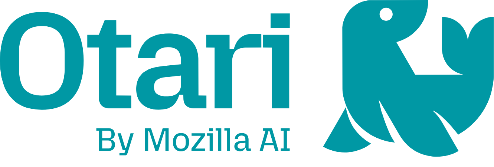
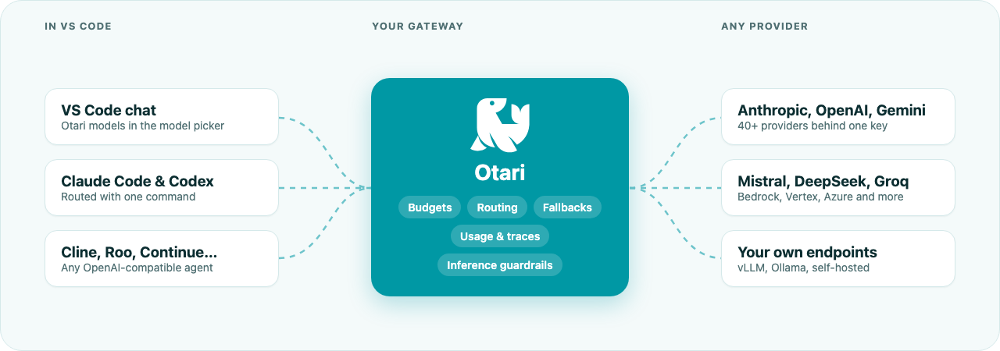

<p align="center">
  
</p>

<h3 align="center">Your Otari gateway, inside VS Code.</h3>

<p align="center">
  Chat with any model your gateway serves, send Claude Code and Codex through it, and see your Agent
  Guardrails where you write them. Budgets, routing and usage stay with Otari.
</p>

<p align="center">
  <a href="https://marketplace.visualstudio.com/items?itemName=mozilla-ai.otari-vscode"></a>
  <a href="https://open-vsx.org/extension/mozilla-ai/otari-vscode"></a>
  <a href="https://otari.ai"></a>
  <a href="https://github.com/mozilla-ai/otari/blob/main/docs/index.md"></a>
  <a href="https://github.com/mozilla-ai/otari"></a>
  <a href="https://discord.gg/ZfZPfTdtSe"></a>
  <a href="LICENSE"></a>
</p>

<p align="center">
  
</p>

---

## Features

### 💬 Otari models in VS Code chat

Every chat model your API key can call appears in the chat model picker, next to the ones you already use,
and to any extension built on VS Code's language model API. Agent mode works: tool calls stream through
Otari like any other request.

- **One key, every provider.** Anthropic, OpenAI, Gemini and the rest of what your gateway serves.
- **Your rules apply.** Budgets, routing policies, fallbacks and inference guardrails run on every request.
- **Attributed spend.** Requests are tagged `source=vscode`, so the dashboard's Usage page can filter them.
- **Cost in the status bar.** The Otari mark shows what chat in this window has cost so far.

### 🔀 Route coding agents through Otari

**Otari: Route Coding Agents Through Otari** configures the agent you pick, and **Stop routing** undoes it.

| Agent | What it sets up | Where your key goes |
| --- | --- | --- |
| **Terminals in VS Code** | `claude` and `codex --profile otari` started in a new integrated terminal use Otari. | Memory only, rebuilt from secret storage on start. |
| **Claude Code extension** | The `claudeCode.environmentVariables` setting, after asking. | Your user `settings.json`, in plain text: it is the only place the extension reads its environment from. |
| **Codex** | An `otari` provider and profile in `~/.codex/config.toml`. Plain `codex` keeps your default. | Nowhere: Codex reads `OTARI_API_KEY`. |
| **Cline, Roo Code, Kilo Code, Continue** | Copies the base URL and setup for the agent's OpenAI-compatible provider form. | Wherever that agent keeps it. |

### 🛡️ Agent Guardrails in the editor

A repository's [Agent Guardrails](https://github.com/mozilla-ai/otari/blob/main/docs/agent-guardrails.md),
the gates in `.otari/` that stop a coding agent from doing what your `AGENTS.md` forbids, are validated
whenever you save one. Each finding lands in **Problems** on the gate that caused it.

From the command palette or the status bar menu you can also:

- **Dry run** a command or a path against the guardrails before an agent tries it.
- **Check changes** on your branch, the way CI does.
- **Register the hook** for Claude Code or Codex in this repository.
- **Generate gates** from the repository's `AGENTS.md` or `CLAUDE.md`.

Agent Guardrails run locally through the `otari` command and need no account:
`brew install mozilla-ai/tap/otari`.

## Getting started

1. **Install** Otari from the Extensions view, the [Visual Studio Marketplace](https://marketplace.visualstudio.com/items?itemName=mozilla-ai.otari-vscode) or [Open VSX](https://open-vsx.org/extension/mozilla-ai/otari-vscode).
2. **Sign in.** Accept the prompt, or run **Otari: Sign In**. Pick otari.ai, its EU region or your own
   gateway, then paste an API key. A key from the other otari.ai region is detected and the gateway
   switched for you.
3. **Pick a model.** In chat, open the model picker, choose **Manage Models…** and enable the Otari models
   you want.
4. **Explore.** Click the Otari mark in the status bar for every other command.

Don't have a key? [Create one on otari.ai](https://otari.ai), or
[run your own gateway](https://github.com/mozilla-ai/otari/blob/main/docs/quickstart.md) with Docker.

> [!NOTE]
> On your own gateway, the key Claude Code uses needs **Mismatched `user` field: Always accept**. See
> [Use with Claude Code](https://github.com/mozilla-ai/otari/blob/main/docs/use-with-claude-code.md#on-your-own-gateway).

## Commands

| Command | |
| --- | --- |
| **Otari: Sign In** / **Sign Out** | Connect to otari.ai or your own gateway. |
| **Otari: Show Menu** | Everything below, from the status bar. |
| **Otari: Route Coding Agents Through Otari** | Set up Claude Code, Codex and other agents. |
| **Otari: Refresh Models** | Reload the models your key can call. |
| **Otari: Open Dashboard** | Usage, keys and budgets in the browser. |
| **Otari: Validate Agent Guardrails** | Check `.otari/` and report findings in Problems. |
| **Otari: Dry Run Agent Guardrails Against a Command or Path** | See which gates would fire. |
| **Otari: Check Changes Against Agent Guardrails** | Run the gates against your branch. |
| **Otari: Register the Agent Guardrails Hook** | `otari hook setup` for Claude Code or Codex. |
| **Otari: Generate Agent Guardrails From AGENTS.md** | Propose gates from your written rules. |
| **Otari: Reset Session Spend** | Zero the status bar's cost. |

## Settings

| Setting | Default | |
| --- | --- | --- |
| `otari.gatewayUrl` | `https://api.otari.ai` | The gateway, without `/api/v1`. Use `https://eu.api.otari.ai` for the EU region. |
| `otari.dashboardUrl` | empty | Defaults to otari.ai's dashboard, or the gateway URL for your own gateway. |
| `otari.chat.models` | `[]` | Offer only these model ids in chat. Empty offers every chat model. |
| `otari.chat.tags` | `{"source": "vscode"}` | Request tags sent with every chat request. |
| `otari.cliPath` | `otari` | The `otari` command for Agent Guardrails. |
| `otari.guardrails.validateOnSave` | `true` | Validate when a file under `.otari/` is saved. |

## Privacy and security

- Your API key is stored in VS Code's secret storage. It is written elsewhere only when you route the
  Claude Code extension, which reads it from your settings, and the extension asks before it does.
- Chat requests go to the gateway you signed in to and nowhere else. The extension sends no telemetry.
- Agent Guardrails run on your machine through the `otari` command.

## Known limits

- The status bar shows what chat in this window cost, from the cost Otari returns with each response. An API
  key cannot read its organization's total usage or remaining budget, so those are on the dashboard.
- VS Code asks for token counts often, so they are estimated (about four characters a token).

## Contributing

```sh
npm install
npm run build              # bundle to dist/
npm test                   # unit tests, and the client against the mock gateway
npm run test:integration   # in VS Code: guardrail findings land on the right line
npm run test:e2e           # in VS Code: sign in, chat and a tool call against the mock gateway
npm run package            # otari-vscode-<version>.vsix
```

Set `VSCODE_PATH` to run the VS Code tests on your own install, for example
`VSCODE_PATH="/Applications/Visual Studio Code.app/Contents/MacOS/Code"`.

Press **F5** to start an Extension Development Host. `npm run mock` starts a stand-in gateway on
`http://localhost:8787` that accepts any key, lists a `mock:fast` model, echoes what you say, and calls the
first tool it is offered when you ask it to "use a tool". The keys `bad` and `eu` exercise the 401 and 421
paths. `npm run icons` rebuilds the status bar icon font from `media/otari-mark.svg`, and
`scripts/how-it-works.html` is the source of `media/how-it-works.png`.

## Releasing

1. Bump `version` in `package.json` and add its section to `CHANGELOG.md`.
2. Merge, then tag the merge commit: `git tag v0.1.4 && git push origin v0.1.4`.

The [Release workflow](.github/workflows/release.yml) checks the tag matches `package.json`, attaches the VSIX
to a GitHub release, and publishes it to [Open VSX](https://open-vsx.org/extension/mozilla-ai/otari-vscode) and
the [Visual Studio Marketplace](https://marketplace.visualstudio.com/items?itemName=mozilla-ai.otari-vscode).
Open VSX uses the `OVSX_PAT` secret in the `open-vsx` environment. The Marketplace needs no secret: the
`mozilla-ai` publisher's Trusted Publishing policy accepts this workflow running in the `vs-marketplace`
environment. Both environments accept `v*` tags only. To publish an existing tag again, run the workflow by
hand with that tag.

## License

[Apache 2.0](LICENSE). Otari is built by [Mozilla.ai](https://mozilla.ai).
